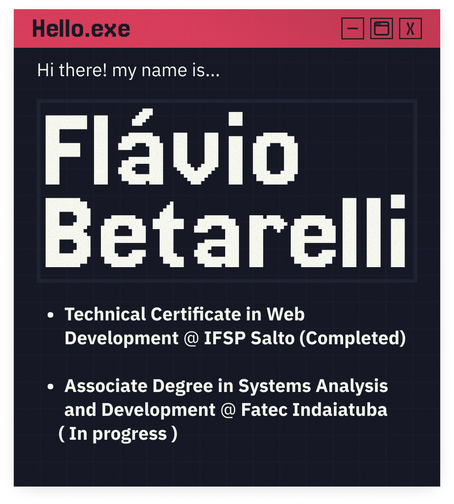
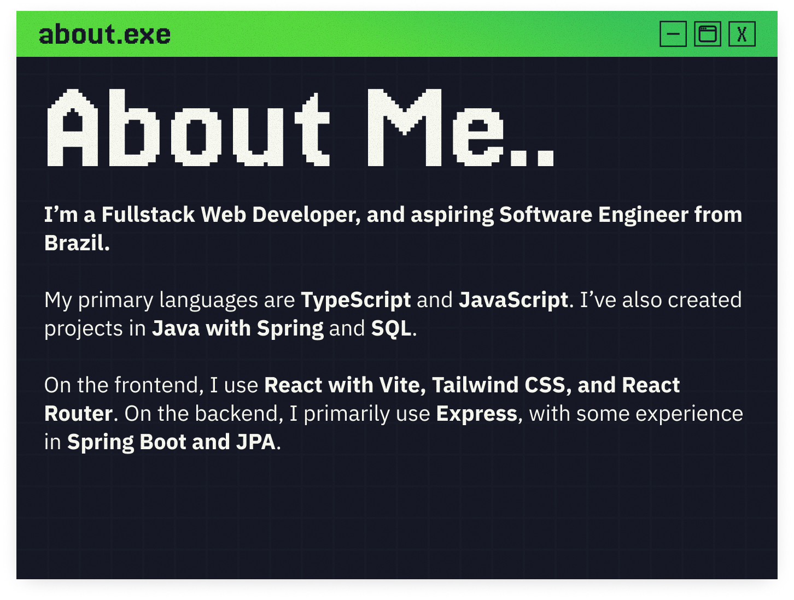
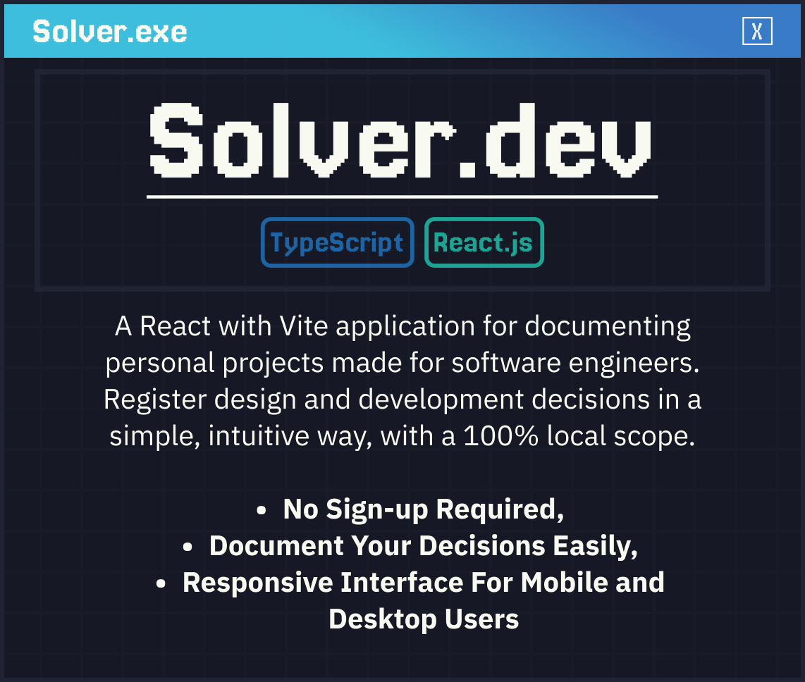
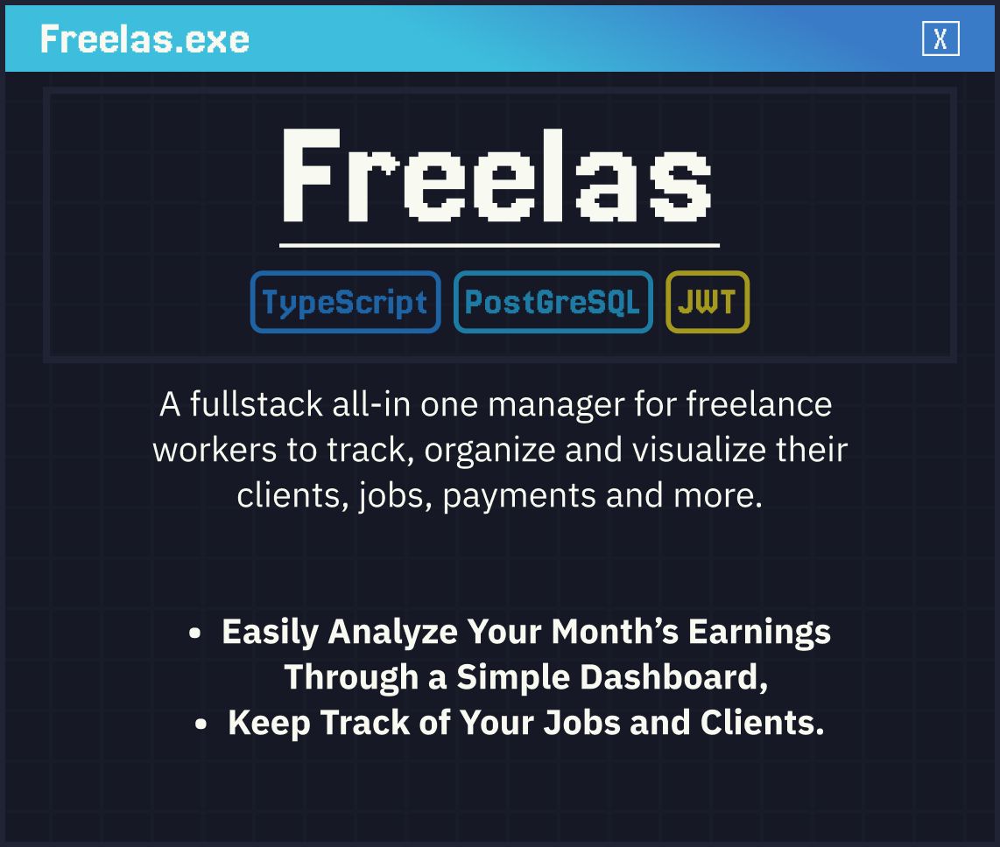
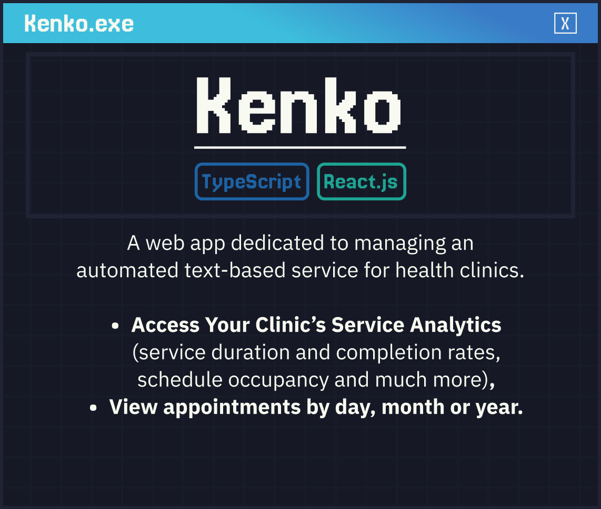

<!-- Cards are designed in Figma. Replace individual exports in assets/profile/ to update their content. -->

<table>
  <tr>
    <td width="41%" valign="top">
      
    </td>
    <td width="59%" valign="top">
      
    </td>
  </tr>
</table>

<table>
  <tr>
    <td width="50%" valign="top">
      
    </td>
    <td width="50%" valign="top">
      
    </td>
  </tr>
  <tr>
    <td width="50%" valign="top">
      
    </td>
    <td width="50%" valign="top"></td>
  </tr>
</table>

  

